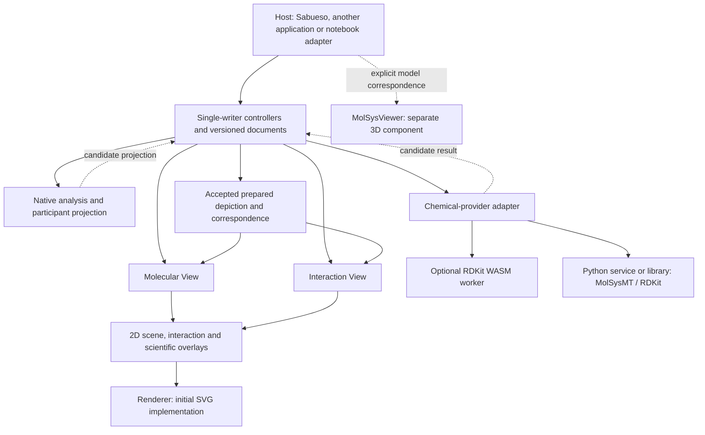

# Architecture

Status: agreed separation of responsibilities; proposed module/API design.
The supplied-document validation and replacement-controller subset is implemented
in `src/`; rendering, chemistry/native-result adapters and the visual stack below
remain target architecture. See [the executable profile](SUPPLIED_INPUT_PROFILE.md).

## Layers

The document contains molecular and presentation state with separate revisions.
The controller validates host actions and applies accepted state transitions.
An accepted [prepared depiction](DEPICTION_CONTRACT.md) separates the chemical
interpretation from its drawing representation. The scene builds primitives,
text geometry and semantic hit regions from that depiction. The renderer
projects a coherent scene into the host viewport.

Use one writer for each live document. The controller owns acceptance of host
commands and provider candidates; providers never mutate its accepted state or
host-owned inputs in place. The document is a visual/editing projection and
draft envelope, not a replacement for MolSysMT's general molecular model.

Molecular View and Interaction View are primary sibling surfaces. The former
uses a molecular interpretation/draft; the latter uses a visual document
referencing exact molecular parents and native observations. Both share
depiction fragments and scene primitives. Neither needs an existing mounted
instance of the other.

The native-result adapter projects existing scientific records. It does not
perform detection, define a competing Interactions codec or merge participants
into one molecular entity. Each controller writes its own visual/document
state; immutable scientific parents remain owned by their providers.

The chemical-provider adapter handles an explicitly selected operation and
route. Implement one route first. A Python route and a browser WASM route are
alternative capabilities to qualify, not mandatory simultaneous dependencies.

## Dependency direction

The core must not import Sabueso, Qt, a notebook runtime or a frontend framework.
Host adapters translate their own lifecycle and communication into the core
contract. A future Python companion remains optional for supplied-document
viewing; its supported operations and required providers must be explicit.

Chemical providers do not control host panels, selection policy or source
navigation. Renderers do not perform chemical normalization or scientific
calculations. A generic visual primitive does not acquire the scientific
definition of the overlay it displays.

## Proposed source boundaries

| Boundary | Responsibility |
| --- | --- |
| document | Typed graph/draft envelope, stable IDs, revisions and serialization |
| controller | State transitions, capabilities, operation coordination and events |
| depiction | Prepared chemical drawing information and explicit semantic/display correspondence |
| interaction-document/projection | Multi-parent/native-analysis references, participants, coverage and reversible diagram projections |
| diagram-layout | Ligand-centered and two-sided visual constraints, routing, grouping and pins |
| scene | Atom/bond geometry, labels, overlays and hit regions |
| renderers/svg | SVG primitives, viewport projection and graphical export |
| input-tools | Pointer/keyboard tools, selection and nonmutating exploration for both views |
| chemistry | Provider-neutral requests, results and adapters |
| adapters | Web-host integration and later optional Python/notebook bridges |

Actual package names and directories are chosen in P0.5. Avoid a plugin
framework or many independently published packages before there is a concrete
extension need.

## Asynchronous work

Pointer movement, selection and viewport operations remain local. Submit
expensive chemistry outside the UI thread through a worker or service. Coalesce
superseded work where appropriate; never issue a chemical RPC for each pointer
movement.

Every request carries document identity, declared input dependencies, request
identity, output destination, operation, provider route and options. Accept
a result only while both its input dependencies and destination request/policy
generation remain applicable.

Two layouts can share one chemical revision but differ in options or user
intent. The older completion must not overwrite the selected newer one.
Manual changes to the destination also retire incompatible pending work.
Cancellation is an optimization; applicability checks are required even if
an engine cannot interrupt a running operation.

Accepted generations are monotonic, including undo/redo. Equivalent chemical
content or a reused cache entry does not revive an old callback. Independent
layer destinations can have independent pending requests. Scientific
dependencies may include a provider's conformer/frame/configuration, not only
the molecular graph.

Do not silently fall back to another chemical method when a provider is absent.
Offer declared capabilities and actionable diagnostics.

## Lifecycle

Receive initialization readiness explicitly. Support document replacement,
resize, event unsubscription and disposal as real operations. Dispose only
owned DOM, observers, handlers, workers, provider objects and runtime handles.
Shared resources need an explicit owner and reference-lifetime policy.

No callback from a retired instance may mutate its replacement. Multiple views
must have independent identities and may share only explicitly declared
immutable inputs or owned services.

Keep runtime lifecycle, accepted document/draft validity and individual
operation status orthogonal. A valid displayed molecule can coexist with a
failed replacement attempt or pending calculation. Prepare replacement
interpretation, depiction and scene before committing the accepted snapshot;
failure leaves the previous accepted view available.

## Replaceable infrastructure

Keep the host, transport, chemical provider and renderer behind bounded
contracts. Preserve public meaning, IDs and lifecycle when one changes.
Define narrow contracts from the initial use case; add implementations after
measurements or consumer needs justify them.

SVG is the first renderer to evaluate. RDKit-generated depictions provide a
reference for chemical/visual comparison. Canvas, another layout route or a
different desktop shell can be evaluated later without changing source
identity or turning presentation state into chemical truth.

## Bounded pending work

Stale-result rejection protects accepted state; it does not limit CPU,
queued messages or retained payloads. The selected adapter/host owner must
bound in-flight work, pending requests/payloads and per-operation size/time.
Share owned service capacity explicitly rather than multiplying it silently
for every view.

Only operations declared supersedable, such as requested visual layouts, may
replace older pending work for the same destination. An explicit scientific
job retains its owning lifecycle and cannot disappear through UI coalescing.
A cancellation request does not release an occupied slot until execution has
actually ended or the owned operation has been safely stopped.

Report overload or unsupported size without corrupting the current document,
inventing a scientific negative or silently changing method. Do not use
message posting as an unlimited queue. The
[worker messaging API](https://developer.mozilla.org/en-US/docs/Web/API/Worker/postMessage)
queues receiver tasks; queue admission remains application work. No generic
distributed resource manager is required for the initial adapter.
