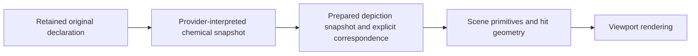

# Chemical interpretation and prepared depiction

Both primary views consume prepared depictions. Interaction View composes
depiction fragments and context summaries without mounting a complete
Molecular View for each participant. Each fragment retains its molecular
parent/subselection and semantic/display mapping.

Status: proposed refinement from the
[conceptual review](CONCEPTUAL_REVIEW.md). This is an implementation contract
to receive in P1.6, not an implemented provider API or frozen schema.

The initial [supplied-input profile](SUPPLIED_INPUT_PROFILE.md) accepts explicit
bijective maps and refuses generated/condensed objects. Its structural tests
do not establish actual provider drawing chemistry or visual correctness.
The [RDKit source route](RDKIT_PROVIDER.md) now supplies real preparation and
native round-trip controls for that bounded profile; own-renderer receiving
and broader preparation remain pending.

## Distinct representations

The interpreted snapshot belongs to a named provider policy and input revision.
The prepared depiction supplies the information needed to draw that snapshot
correctly. The scene owns visual geometry and interaction. Each transition
keeps its origin and correspondence; none silently replaces the original input.

This separation is required even if the first adapter returns all information
in one payload. It does not require separate services, packages or duplicated
chemical algorithms.

## Why coordinates are insufficient

RDKit's drawing preparation can change bond representation, assign wedges and
add certain chiral hydrogens to a depiction copy. Its current
[preparation implementation](https://github.com/rdkit/rdkit/blob/79045367d04b6f9d11e29ae73f3e1d6b210d9641/Code/GraphMol/MolDraw2D/MolDraw2DUtils.cpp)
is a concrete reason to distinguish interpreted and drawing graphs.

A renderer may also need provider-supplied hydrogen counts, aromatic/ring
context, unknown-stereo markers and directed bond depiction. It must not
recover chemical meaning by guessing from 2D geometry or counting lines.

## Minimum prepared snapshot

| Content | Contract |
| --- | --- |
| Basis | Exact document/chemical input, provider policy/options and depiction generation |
| Objects | Stable depiction IDs and links to semantic atom/bond IDs where established |
| Layout | Coordinates and declared axis/orientation; generated or preserved-input policy |
| Labels | Chemical fields needed for correct isotope/charge/H/stereo presentation |
| Bonds | Semantic relation plus supported stroke/endpoint orientation, including unknown states |
| Generated/condensed objects | Explicit origin, correspondence and supported picking semantics |
| Coverage | Supported features, missing information and allowed operations |

Style, typography, label placement and hit geometry remain scene concerns.
The provider's semantic/depiction information is not a mandatory SVG scene
format. Do not make a particular toolkit's internal JSON the public document.
Inspect standard interchange before inventing a new chemical encoding.

The first adapter need only cover the admitted feature matrix. It must report
unavailable prepared fields explicitly instead of implementing hidden chemistry
in TypeScript.

## Correspondence and visual objects

Many original atoms can eventually be represented by one abbreviation, and
display preparation can introduce objects without an explicit source atom.
Do not assume all source/semantic/depiction mappings are bijections.

Keep mapping kinds and cardinality explicit. A generated hydrogen may have a
declared parent/expansion origin without claiming an exact atom identity in a
source or 3D model. A condensed label selects its declared set or reports the
unsupported operation; it does not silently select the first atom.

Do not expand initial scope to abbreviations or generated atoms just to satisfy
this architecture. The initial provider may explicitly disable such preparation
or reject an unsupported case while preserving its original input.

## Stereo and transforms

Semantic stereochemistry, drawing wedges and a computed CIP label are different
records. Preserve known, unspecified, unknown and unsupported states according
to the selected chemical contract.

A directed wedge keeps its originating endpoint. Reordering an undirected bond
tuple cannot silently reverse its depiction. Screen-axis conversion, rotation,
resizing, reflection and later atom dragging must preserve the admitted stereo
meaning or be rejected/re-prepared explicitly.

Keep reflection disabled until its semantics are received. A generic SVG
transform is not chemical validation. Layout cleanup cannot silently change
protonation, tautomer, charge or stereo interpretation.

## Snapshot publication

Prepare candidate interpretation/depiction/scene state without mutating the
accepted document or host-owned provider objects. Publish a coherent snapshot
through the controller only after its scope and mappings are validated.

Required interpretation/depiction must be coherent before acceptance. Optional
scientific layers may finish independently and must not delay the first useful
view unless the host explicitly requires them.

Failed replacement preserves the accepted molecule and reports the attempted
input failure. An editor may explicitly accept an invalid draft; that is a
different transition from a failed viewer import.

Each hit result and overlay anchor identifies the depiction/scene generation
it belongs to. Update label metrics, rendered geometry and hit regions
together when fonts, viewport or layout change.

## Diagram composition

Context layout positions chemical depictions as coherent objects. It never
applies graph forces to their atom positions or changes stereo meaning.
Summary/expanded representations retain reversible participant membership.
Physical projection and chemical-layout modes have distinct coordinates and
meaning; their apparent distances must not be conflated.
